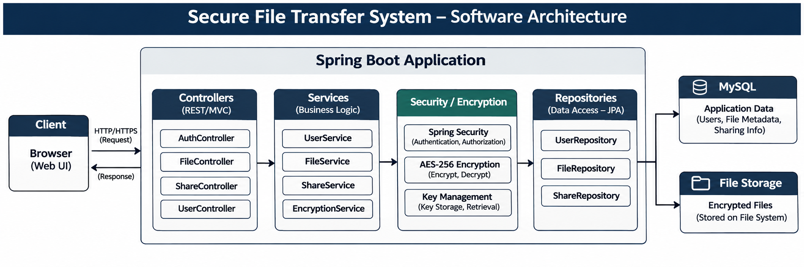
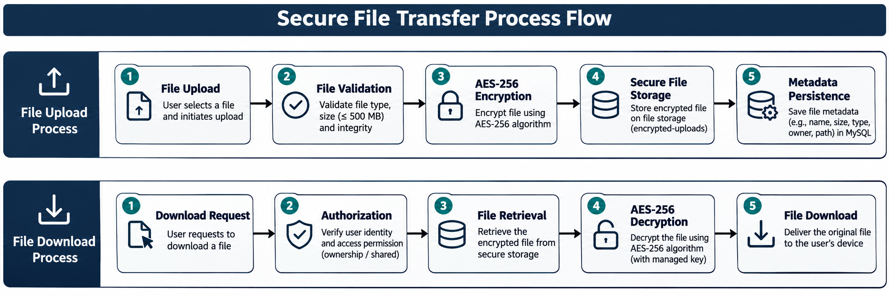
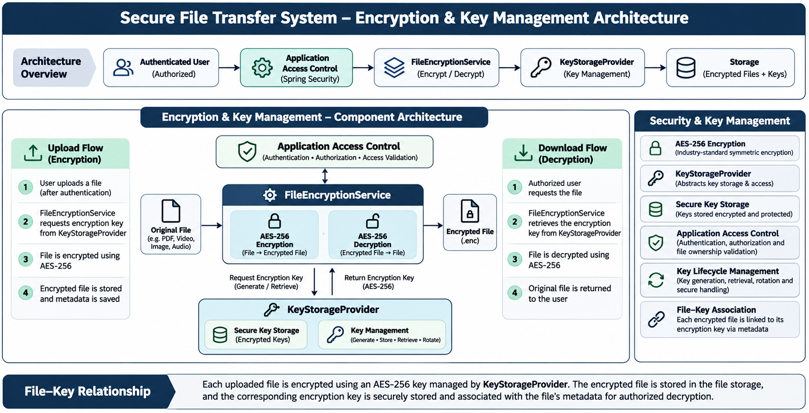
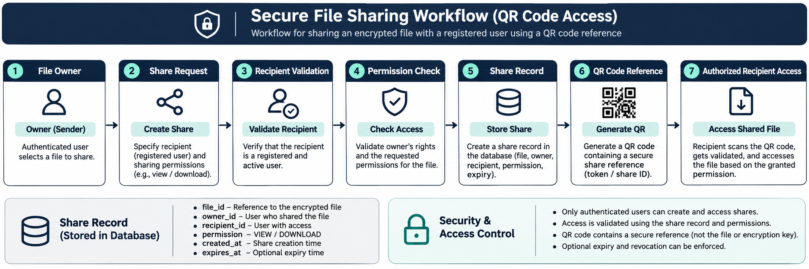
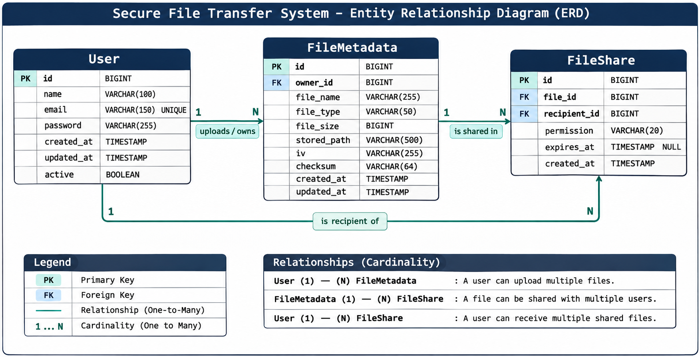

# Secure File Transfer System

A secure web-based file transfer application built with **Java and Spring Boot**. The system allows authenticated users to upload, encrypt, store, download, delete, and share files through a web interface.

The project focuses on **authentication, access control, AES-256 file encryption, secure key handling, and controlled file sharing**.

---

## Features

- User registration and login
- Authentication and authorization
- Secure file upload and download
- File deletion and metadata management
- File type and size validation
- **AES-256 file encryption**
- Separate encryption key management
- User-to-user file sharing
- Access validation for shared files
- Support for documents, images, audio, video and other supported files
- Configurable upload limit up to **500 MB**
- Web-based frontend
- MySQL-based persistent storage

---

## Technology Stack

| Component | Technology |
|---|---|
| Backend | Java, Spring Boot |
| Web Layer | Spring MVC |
| Security | Spring Security |
| Database | MySQL |
| ORM | Hibernate / JPA |
| Frontend | HTML, CSS, JavaScript |
| Build Tool | Maven |
| Encryption | AES-256 |
| Version Control | Git / GitHub |

---

## System Architecture

The application follows a layered architecture where controllers handle requests, services implement business logic, security components handle access and encryption, and repositories communicate with MySQL.



---

## Secure File Transfer Flow

### Upload

```text
User
 │
 ▼
Authentication
 │
 ▼
File Upload
 │
 ▼
Validation
 │
 ▼
AES-256 Encryption
 │
 ▼
Encrypted File Storage
 │
 ▼
Metadata → MySQL
```

### Download

```text
User
 │
 ▼
Authentication
 │
 ▼
Access Validation
 │
 ▼
Encrypted File
 │
 ▼
Decryption
 │
 ▼
File Download
```



---

## Encryption & Key Management

Files are protected using an **AES-256 based encryption layer** before secure storage.

Encryption keys are handled separately through a dedicated key-storage abstraction.

```text
File
 │
 ▼
FileEncryptionService
 │
 ▼
AES-256
 │
 ▼
Encrypted File
 │
 ▼
Storage
```

```text
KeyStorageProvider
        │
        ▼
FileSystemKeyStorageProvider
        │
        ▼
Encryption Key
```



---

## File Sharing

A user can share a file with another registered user.

```text
Owner
 │
 ▼
Select File
 │
 ▼
Select Recipient
 │
 ▼
Create Share
 │
 ▼
Permission Validation
 │
 ▼
Recipient Access
```

The sharing layer maintains the relationship between the file, owner and recipient.

### QR Sharing

QR-based sharing can be used to provide a controlled share reference.

The QR code should contain a **temporary/controlled reference**, not the actual file or encryption key.



---

## Database

MySQL stores application data such as users, file metadata and sharing information. File contents are handled separately by the file-storage layer.



---

## Project Structure

```text
secure-file-transfer/
├── src/
│   ├── main/
│   │   ├── java/
│   │   │   └── com/yashsomani/secure_file_transfer/
│   │   │       ├── controller/
│   │   │       ├── service/
│   │   │       ├── repository/
│   │   │       ├── security/
│   │   │       ├── entity/
│   │   │       └── dto/
│   │   └── resources/
│   │       └── static/
│   │
├── docs/
│   └── diagrams/
│
├── pom.xml
├── mvnw
├── mvnw.cmd
└── README.md
```

---

## Configuration

Create the MySQL database:

```sql
CREATE DATABASE secure_file_transfer;
```

Configure local database credentials:

```properties
spring.datasource.url=jdbc:mysql://localhost:3306/secure_file_transfer
spring.datasource.username=YOUR_USERNAME
spring.datasource.password=YOUR_PASSWORD

spring.servlet.multipart.max-file-size=500MB
spring.servlet.multipart.max-request-size=510MB
```

**Do not commit database passwords, encryption keys or other secrets to GitHub.**

---

## Running the Project

### Windows

```powershell
mvnw.cmd spring-boot:run
```

### Linux / macOS

```bash
./mvnw spring-boot:run
```

Run tests with:

```bash
mvnw.cmd test
```

---

## Security

The project uses multiple security layers:

- Authentication before protected operations
- Authorization for file access
- File ownership validation
- Shared-file permission validation
- File size/type validation
- AES-256 encryption
- Separate encryption-key handling
- Local secret/configuration protection

For production deployment, additional controls such as **HTTPS, rate limiting, audit logging, malware scanning, external key management and secure object storage** can be added.

---

## Future Improvements

- QR-based secure sharing
- Expiring share links
- Share revocation
- One-time download links
- File integrity/checksum verification
- Audit logging
- HTTPS deployment
- Docker deployment
- Cloud object storage
- External Key Management Service
- Large-file streaming and resumable uploads

---

## Project Status

Academic project focused on implementing a practical secure file transfer system using **Spring Boot, MySQL and AES-256 encryption**, with authenticated file management and controlled file sharing.

---

## Author

**Yash Somani**  
Information Technology

GitHub: [oOyashOo](https://github.com/oOyashOo)